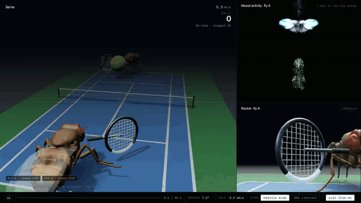

# Connectome ping pong

Two simulated flies rally a ball. Each fly runs the full wiring map of a real male fruit fly's brain and nerve cord. Nothing in the match is trained.



You can watch the full video at [fly.warpfield.me](https://fly.warpfield.me). For the interactive replay, download [`site/fly-tennis.html`](site/fly-tennis.html) and open it in your browser. It is a single file with everything inside.

## What it is

A connectome is a map of every neuron in a brain and every connection between them. This project loads the MaleCNS v1.0 connectome, which covers a male fly's brain and nerve cord, and runs it as a network of 163,903 neurons. If you keep only connections with 5 or more synapses, which is the usual cutoff, you get 6,235,682 connections carrying 89,731,552 synapses.

Two copies of that network get a pair of eyes and stand at opposite ends of a small tennis court. Each eye has 721 ommatidia, the tiny lenses that make up a fly's compound eye. The fly reads the ball's direction from its own visual neurons and walks toward it.

## Why it is interesting

Many connectome demos script the body and let the brain choose from moves someone wrote by hand. Here the steering comes from the wiring. Synapse counts and signs come straight from the data, and no weight is fit to the game.

That makes the test simple. If the real wiring matters, scrambling it should hurt the flies. It does.

## Results

Each run is a 40 second match with the same random seed and the same ball physics. Only the source of the steering signal changes.

| Run | Hits | Longest rally |
|---|---|---|
| Wiring as measured, steering from the medulla | **54** | **54, no miss** |
| Control: no steering, fly parked at center | 14 | 6 |
| Control: steering from descending neurons DNa01/02 | 12 | 6 |
| Control: shuffled wiring, same decoder | 10 | 4 |

Descending neurons carry commands from the brain to the body, and DNa01/02 help steer walking. The shuffled control keeps every synapse and every sign but connects them at random. With that wiring the flies do worse than flies that never move at all.

You can also check the decoder with the loop open. Before each match, the code places the ball at nine spots from left to right and reads the bearing the fly decodes, without letting the fly move. With the real wiring the bearing falls in order: 13, 10, 8, 3, 1, -4, -8, -9 and -16 degrees, where positive means left. With shuffled wiring it jumps around: 4, 6, -16, -15, -12, -9, 2, 26 and 18. Both sweeps are printed in the logs in `cache/v2/logs/`.

## How it works

1. **Load the wiring.** `flypp/connectome.py` reads three MaleCNS data files and keeps connections with at least 5 synapses. It gives each neuron a sign from its predicted transmitter. Acetylcholine, dopamine, octopamine and serotonin excite. GABA, glutamate and histamine inhibit.
2. **Run it as a network.** `flypp/network.py` follows the flyvis model. Each neuron has a voltage that moves toward the weighted sum of its inputs. The code scales each neuron's inputs by its total synapse count and caps its firing rate, which keeps the whole network stable.
3. **Build the eyes.** `flypp/vision.py` works out where each of FlyGym's 721 ommatidia points, using geometry instead of a renderer. Its median error against real renders is 0.84 degrees. `RetinotopicMap` in `flypp/loop.py` lines up the eye's hex grid with the hex grid of columns in the medulla, a layer of the fly's visual system, so each column listens to the lens that looks the same way.
4. **Find the ball.** `BumpDecoder` reads four medulla cell types that respond to small objects: Mi1, Tm3, T2 and T3. It compares each cell with a twin network that never sees the ball, then averages the directions of the 16 cells that differ most. That average is the fly's bearing to the ball.
5. **Move and swing.** The fly steps sideways along its baseline toward that bearing, at up to 16 mm/s. The code swings the racket as the ball arrives. Gravity, bounces, the net and racket contact all run as physics, so a fly in the wrong spot misses.

The replay page shows fly A's brain and nerve cord (7,000 of the 163,903 neurons) colored by activity, a close-up of fly A's racket, and a strip with the decoded bearing and walking speed.

## Run it

### See the replay

This rebuilds `site/fly-tennis.html` from the saved match recordings in `cache/v2/`. You only need Python and numpy, and it takes about a second.

```bash
python phase0/build_tennis_page_v2.py cache/v2/tennis_bump.json cache/v2/tennis_contrast.json cache/fly_mesh.json site/fly-tennis.html
```

### Run the matches yourself

This downloads 566 MB of connectome data from the public FlyEM bucket.

```bash
python -m venv .venv && . .venv/bin/activate
pip install -r requirements.txt

mkdir -p data && cd data
for f in connectome-weights-male-cns-v1.0-minconf-0.5-traced-only.feather \
         body-annotations-male-cns-v1.0-minconf-0.5.feather \
         body-neurotransmitters-male-cns-v1.0.feather; do
  curl -O https://storage.googleapis.com/flyem-male-cns/v1.0/connectome-data/flat-connectome/$f
done
cd ..

python -m flypp.connectome        # writes cache/connectome_thr5.npz
python phase0/build_retino.py     # writes cache/photoreceptor_columns.csv

# the match
python -m flypp.tennis --ckpt "" --tag bump --steer bump --out cache/tennis_bump.json
# controls
python -m flypp.tennis --ckpt "" --tag none --steer none --out cache/tennis_none.json
python -m flypp.tennis --ckpt "" --tag shuffle --steer bump --shuffle --out cache/tennis_shuffle.json
python -m flypp.tennis --ckpt "" --tag contrast --steer contrast --out cache/tennis_contrast.json
```

`--ckpt ""` tells the match to load no checkpoint, so the network runs with the wiring as measured. Each match prints its hits and longest rally at the end.

A match is a heavy job. Every control step runs the full network three times: once for each fly and once for the twin that never sees the ball. It runs on the CPU and uses a GPU if PyTorch finds one.

## What is in the repo

- `flypp/` holds the connectome loader, the network, the eye model, the retina to medulla map, the ball decoder and the match (`tennis.py`). It also keeps training scripts from earlier phases. The match does not use them.
- `phase0/` holds diagnostics, benchmarks, a patch for two FlyGym multi-fly bugs, the mesh export, the page builders and the headless video capture (`capture.js`).
- `cache/v2/` holds the four match recordings and their logs. `bump2.log` is the 54 hit run. `bump.log` is an earlier run of the same match from before the final decoder settings. `cache/fly_mesh.json` holds the fly body meshes exported from FlyGym.
- `site/` holds the landing page, the interactive replay and the video.
- `docs/` holds the GIF at the top of this page.
- `research/` and `PHASE0-RESULTS.md` to `PHASE4-RESULTS.md` are the research notes and build log, dead ends included.

## Limits

- The code triggers the racket swing and picks where each return lands. The connectome only decides where the fly stands.
- In the match the fly slides along its baseline. The simulation does not move its legs.
- The eye model sees a dark ball on a plain background. It has no shading, texture or self occlusion.
- The court is a real tennis court scaled to fly size, then shrunk about 3 times more so the ball stays inside the fly's visual range. At true scale the ball would look smaller than one ommatidium.
- Each result comes from one 40 second match with one seed.
- Which way is front on the medulla column grid is an assumption. It does not change steering.

## Built on

- The MaleCNS v1.0 connectome from Janelia FlyEM and Google, public bucket `gs://flyem-male-cns/v1.0/`.
- FlyGym and NeuroMechFly v2 from EPFL, for the fly body, eyes and meshes.
- The network model follows flyvis (Lappalainen et al., Nature 2024).

MIT license. See [LICENSE](LICENSE).

---

[A Warpfield project](https://warpfield.me)
